<div align="center">

<picture>
  <source media="(prefers-color-scheme: dark)" srcset="public/plothour-logo-dark-teal.png" />
  
</picture>

# Make time for what matters.

**A thoughtful workspace for focused study, visible progress, and a little friendly accountability.**

Track a session. Build a rhythm. See the work add up.

[Explore the app](https://plothour.com) · [Product tour](#a-workspace-for-the-whole-study-routine) · [Screenshots](#two-themes-one-workspace) · [Run locally](#run-it-locally) · [Architecture](#under-the-hood)


<br />

<picture>
  <source media="(prefers-color-scheme: dark)" srcset="docs/screenshots/plothour-timer-dark.jpg" />
  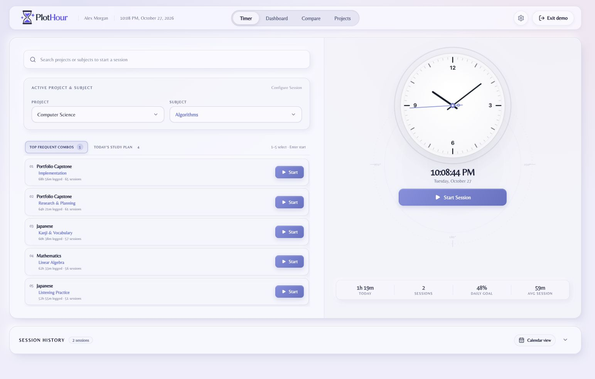
</picture>

<sub>Actual app captures using synthetic demo data. The hero follows your viewing theme.</sub>

</div>

---

## A workspace for the whole study routine

Some days are for learning a new language. Others are for algorithms, exam preparation, or the project you've been meaning to finish. PlotHour gives those hours a place to live—with enough detail to understand your habits and a calm interface to return to tomorrow.

| Start with a plan | Settle into focus | Learn from the pattern | Bring a study partner |
| :--- | :--- | :--- | :--- |
| Organize projects and subprojects, choose study days, and set recurring targets. | Start an open session or choose a 25- or 50-minute target. Return to frequent combinations with keyboard shortcuts. | Explore goal pace, session lengths, weekly trends, and the hours when you tend to study. | Connect by invite code, select comparison profiles, and follow progress over the same period. |

### 01 · A clear place to begin

The **Timer** pairs a clock face with searchable projects, subject selection, frequently used combinations, and today's study plan. Choose a project and optional subject, start a session, and keep a history you can revisit and edit.

- Open-ended tracking plus **25-minute and 50-minute targets**.
- Quick selection with **1–5**, then **Enter** to start a highlighted combination.
- Session history with date filters, notes, and editing controls.
- A calendar one click away from the timer.

### 02 · Progress you can actually read

The **Dashboard** turns recorded sessions into a picture of your routine: weekly and monthly snapshots, project goal pace, focus-duration distributions, study rhythms, and activity heatmaps. Choose a reporting period and customize which sections you see.

<picture>
  <source media="(prefers-color-scheme: dark)" srcset="docs/screenshots/plothour-dashboard-dark.jpg" />
  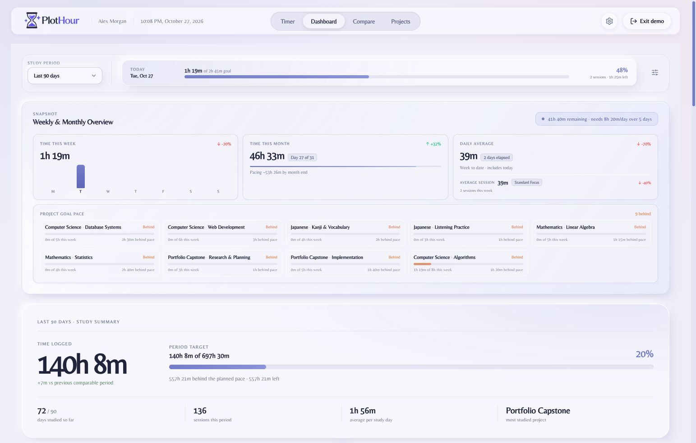
</picture>

### 03 · Your plan and your history, together

The **Calendar** puts planned subprojects and logged study time in the same day cell. Switch between month and week, filter by study area, jump to a date, and inspect that day's sessions. Study intensity has its own heatmap; past days without study receive a quiet grey treatment.

<picture>
  <source media="(prefers-color-scheme: dark)" srcset="docs/screenshots/plothour-calendar-dark.jpg" />
  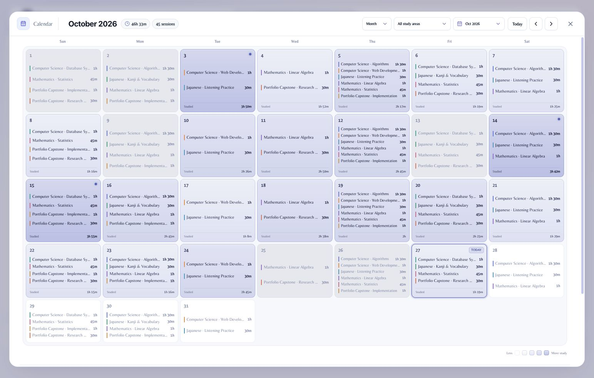
</picture>

### 04 · Accountability with context

**Compare** brings selected profiles into a shared date range. See period standings, changes from the previous period, active days, session counts, and average time per active day. Weekly trends and study-pattern insights add context to the totals; a recap lets you choose metrics to share.

### 05 · A home for every subject

**Projects** is where the routine takes shape. Create and color-code projects and subprojects, set daily/weekly/monthly goals, choose study days, add estimates and milestones, reorder or favorite projects, and archive completed work.

### The details that make it yours

| Capability | What you can do |
| :--- | :--- |
| **Appearance** | Choose light, dark, or automatic daylight appearance. Auto-Daylight uses light mode from 06:00–17:59 and dark mode from 18:00–05:59, based on the device clock. |
| **Preferences** | Set your display name, timezone, date format, week start, and completion sound. |
| **Portable study logs** | Export CSV or JSON; preview and merge a PlotHour JSON session export. |
| **Accounts** | Email/password sign-in, verification and recovery flows, plus optional Google sign-in. |
| **Browser companion** | A Manifest V3 extension with a project picker, timer controls, and a running-time badge. |
| **Administration** | Role-protected account management, signup controls, site branding/copy/assets, and activity reporting. |

## Two themes. One workspace.

**Light** uses pale surfaces and indigo accents. **Dark** uses charcoal surfaces and mint accents. These screenshots were captured from the running app on October 27, 2026, at the same desktop viewport, with generated sample profiles and study history.

Click an image for its full-size version. Expand the gallery to compare both appearances directly.

<details>
<summary><strong>Open the complete light & dark gallery — 10 screenshots</strong></summary>

<br />

| View | Light / white mode | Dark mode |
| :--- | :---: | :---: |
| **Timer** | [](docs/screenshots/plothour-timer-light.jpg) | [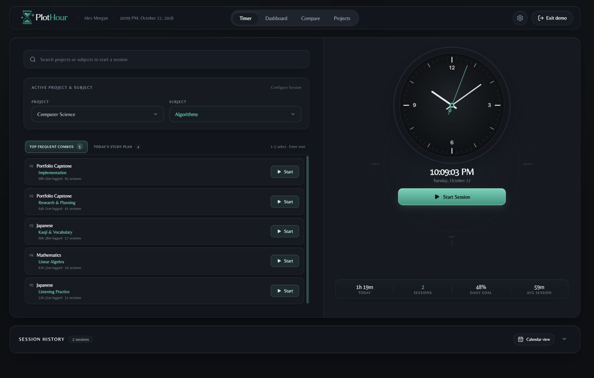](docs/screenshots/plothour-timer-dark.jpg) |
| **Dashboard** | [](docs/screenshots/plothour-dashboard-light.jpg) | [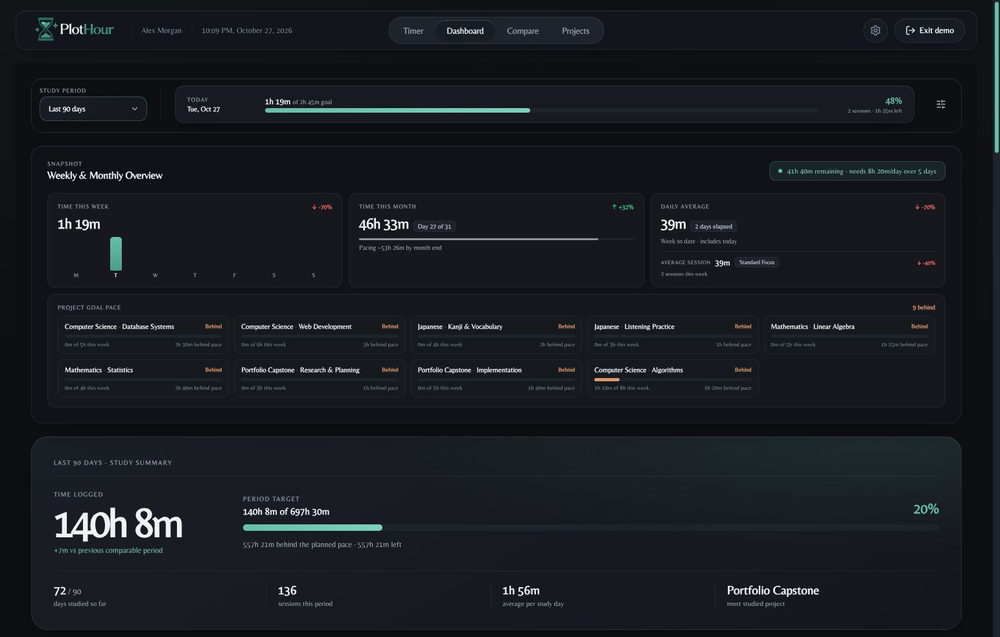](docs/screenshots/plothour-dashboard-dark.jpg) |
| **Calendar** | [](docs/screenshots/plothour-calendar-light.jpg) | [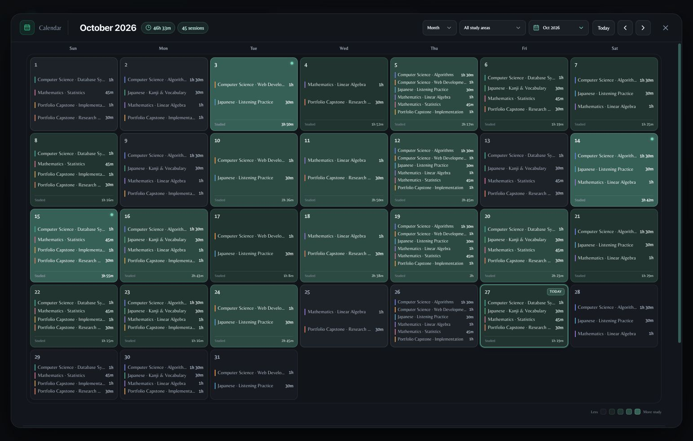](docs/screenshots/plothour-calendar-dark.jpg) |
| **Compare** | [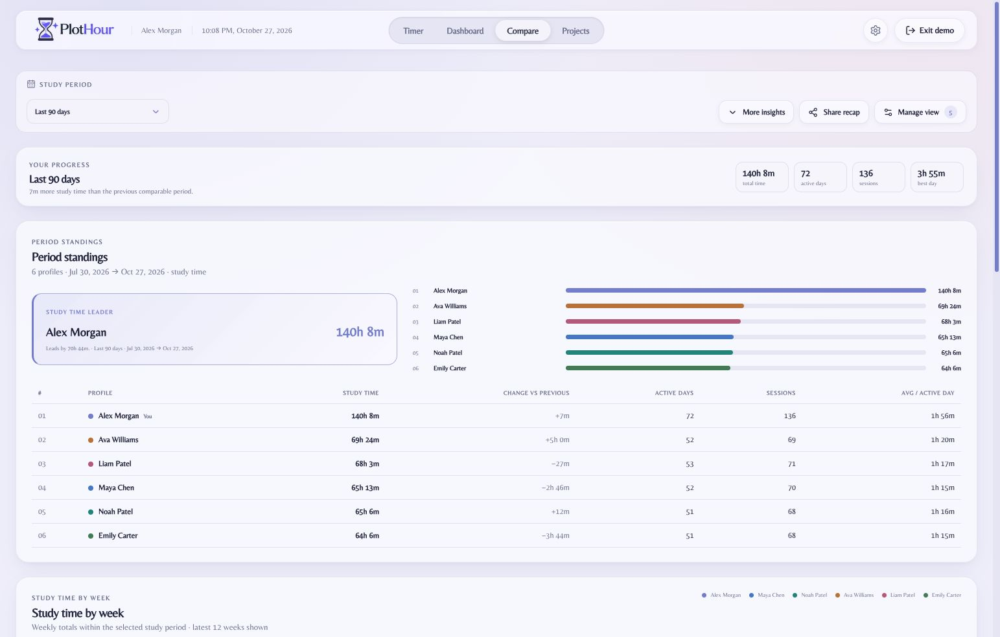](docs/screenshots/plothour-compare-light.jpg) | [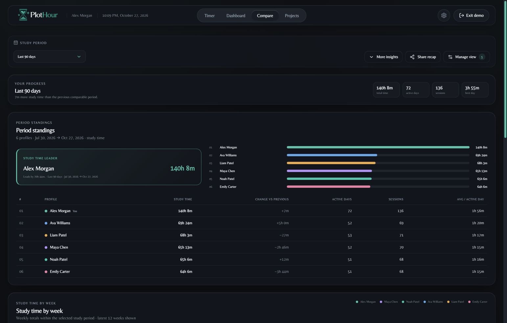](docs/screenshots/plothour-compare-dark.jpg) |
| **Projects** | [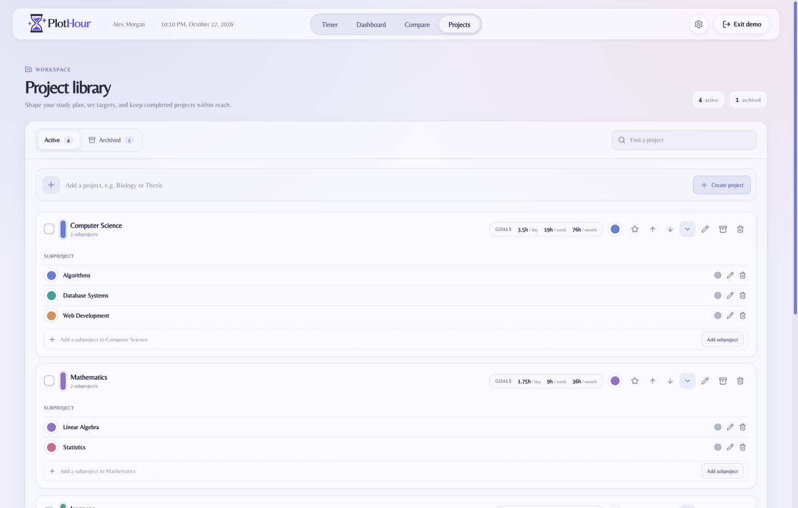](docs/screenshots/plothour-projects-light.jpg) | [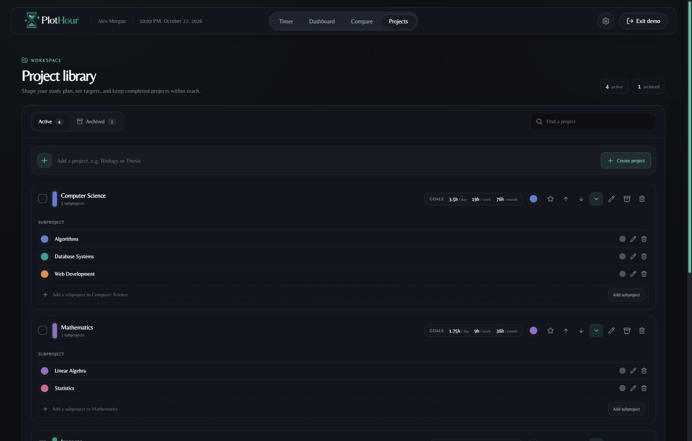](docs/screenshots/plothour-projects-dark.jpg) |

</details>

## Run it locally

### Explore the frontend first

You'll need **Node.js 20.19+ within the 20.x line, or 22.12+**, and npm. The lockfile is included.

```bash
git clone https://github.com/sisirathck/studyduel-2.0.git
cd studyduel-2.0
npm ci
npx vite
```

Open the URL printed by Vite—normally [localhost:5173](http://localhost:5173)—and choose **Try demo**. Demo mode uses generated data in browser storage and does not create an account. Without the API, account features and server-provided customization are unavailable; API proxy errors can appear in the development console.

### Run the full application

Use **Docker Compose** for the included PostgreSQL 16 service, or provide your own PostgreSQL database.

```bash
cp .env.example .env
```

Edit `.env`: choose a database password, use that same password in `DATABASE_URL`, and set `AUTH_SECRET` to a random value of at least 32 characters. Generate one with:

```bash
openssl rand -hex 32
```

Then start the database and application:

```bash
docker compose up -d db
npm run dev
```

The development command starts **Vite** and the **watched Express API** together. Vite proxies `/api` to `http://localhost:3001`. If port 5173 is occupied, use the next port printed by Vite.

The API applies the SQL migrations referenced in `server/index.js` during startup. Wait for the database to be ready before using account features:

```bash
curl http://localhost:3001/api/health
```

Look for `"status":"ok"` and `"databaseReady":true`. If startup reports a database connection failure, wait for PostgreSQL to become healthy and restart `npm run dev`.

### Environment reference

| Variable | Purpose |
| :--- | :--- |
| `POSTGRES_USER`, `POSTGRES_PASSWORD`, `POSTGRES_DB` | Credentials and database name for the Compose database service. |
| `DATABASE_URL` | PostgreSQL connection string used by Express; must match your database configuration. |
| `AUTH_SECRET` | Session-signing secret. Use a unique random value of at least 32 characters. |
| `PORT` | Express port; defaults to `3001`. Update the Vite proxy if you change it for development. |
| `NODE_ENV` | Set to `production` for deployment; affects cookies and email/authentication behavior. |
| `SMTP_HOST`, `SMTP_PORT`, `SMTP_SECURE`, `SMTP_USER`, `SMTP_PASS` | SMTP configuration for verification and password-reset emails. |
| `EMAIL_FROM` | Sender address for account email. |
| `RESEND_API_KEY` | Alternative to SMTP, used with a configured `EMAIL_FROM`. |
| `GOOGLE_CLIENT_ID` | Optional Google sign-in client ID. Configure the application's origin in your Google client settings. |

The values in [`.env.example`](.env.example) are placeholders. Configure SMTP **or** Resend for email delivery; development has console-code fallbacks when no provider is configured. Remove unused placeholder SMTP values to use that fallback. Keep your actual `.env` out of version control.

### Build and serve

```bash
npm run build
NODE_ENV=production npm start
```

Express serves the compiled frontend from `dist/` alongside the API. Deploy with the `database/` migrations available, a reachable PostgreSQL database, configured account email, and HTTPS so production secure cookies work. The Compose file provisions the database only; it does not containerize the application.

## Under the hood

PlotHour uses **React 19 and Vite 8** for the interface, **Express 5** for the API, and **PostgreSQL** for persistence. Styling is plain CSS with theme variables and Lucide icons. Authentication uses Argon2 password hashing and JWT-based sessions; email delivery supports Nodemailer/SMTP and Resend.

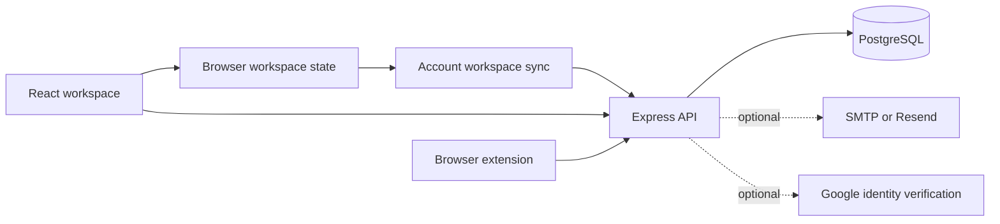

### How data moves today

- **Demo:** generated projects, profiles, and sessions live in browser storage. Demo activity is separate from an authenticated account.
- **Web workspace:** React screens use browser state and account-prefixed local storage. On sign-in, the sync layer loads the account workspace from PostgreSQL; subsequent writes are debounced back to `/api/workspace`.
- **Dedicated APIs:** the backend also provides project and timer endpoints backed by relational tables, alongside connections, authentication, administration, and activity reporting.
- **Comparisons:** connected-account data is fetched through the connections API; demo comparisons use generated profiles.

The current web timer is driven by client timestamps and workspace sync. It does not yet guarantee conflict-free simultaneous editing or server-authoritative timing across devices. The dedicated timer endpoints and browser workspace are separate paths in the current implementation. Failed workspace saves are logged, so local browser state should not replace a verified backup.

### Code map

```text
src/
├── App.jsx                 Authentication, demo entry, workspace initialization
├── components/             Navigation, authentication UI, branding, shared visuals
├── context/                Theme and site customization providers
├── data/                   Demo generation and account workspace synchronization
├── modules/
│   ├── timer/              Clock, session controls, editable history
│   ├── dashboard/          Personal metrics, charts, dashboard customization
│   ├── calendar/           Month/week planning and study history
│   ├── compare/            Profile comparisons, trends, recaps
│   ├── manage/             Project library, subprojects, goals, plans
│   ├── settings/           Preferences, connections, study-log import/export
│   └── admin/              Account and site administration
└── utils/                  Shared date formatting
server/
├── index.js                API setup, migrations, health check, static hosting
├── auth.js                 Password hashing, tokens, cookies, Google verification
├── middleware.js           Authentication and administrator access checks
├── db.js                   PostgreSQL connection pool
└── routes/                 Auth, projects, timer, workspace, connections, admin, analytics
database/                   Numbered SQL migrations
sql/                        Consolidated schema and database guide
extension/                  Manifest V3 browser companion
docs/screenshots/           Product screenshots used in this README
public/                     Logos, icons, static artwork
scripts/                    Development runner and extension icon generation
```

<details>
<summary><strong>API route groups</strong></summary>

| Prefix | Responsibility |
| :--- | :--- |
| `/api/health` | Startup and database readiness. |
| `/api/auth` | Registration, verification, login, Google sign-in, recovery, profile, logout. |
| `/api/projects` | Dedicated project listing and creation. |
| `/api/timer` | Dedicated active-timer, start, stop, and entry-list endpoints. |
| `/api/workspace` | Account workspace loading, initial import, individual key updates. |
| `/api/connections` | Invite codes, study-partner connections, comparison data. |
| `/api/analytics` | Authenticated page-time reporting. |
| `/api/admin` | Role-protected user, signup, customization, and activity administration. |
| `/api/site-config`, `/api/site-assets/:assetId` | Public branding configuration and asset delivery. |

See [`server/routes/`](server/routes/) for request/response behavior and authorization checks.

</details>

## Browser extension

The companion in [`extension/`](extension/) is a **Manifest V3** extension with a toolbar popup, project/task selection, timer controls, and a running-duration badge.

For Chromium-based browsers, open the extension manager, enable **Developer mode**, choose **Load unpacked**, and select this repository's `extension/` directory. See the [extension guide](extension/README.md) for the full workflow and Safari conversion notes. Safari requires a separate conversion/build step.

## Development

| Command | Purpose |
| :--- | :--- |
| `npm run dev` | Start Vite and the watched Express server. |
| `npm run server` | Start Express alone. |
| `npm run build` | Create the frontend production bundle in `dist/`. |
| `npm start` | Start Express, serving `dist/` if it exists. |
| `npm run build:start` | Build and then start Express. |
| `npm run lint` | Run Oxlint. |
| `npm run preview` | Preview the built frontend; this is not the Express API server. |

### Contributing

Start with a focused [issue](https://github.com/sisirathck/studyduel-2.0/issues) or pull request explaining the behavior you want to improve. For UI work, include before/after captures in both themes and check a narrow viewport. For changes to sessions or goals, check that the timer, dashboard, calendar, and comparisons agree.

Run `npm run build` and `npm run lint` before submitting. The repository currently has no automated test script; lint output includes existing warnings. Keep screenshots and examples synthetic, and exclude credentials and personal study histories from contributions.

### Troubleshooting

| Symptom | First thing to check |
| :--- | :--- |
| API returns `503` | Check `/api/health`, database credentials, and server migration logs. Restart the API after resolving a startup failure. |
| Database connection refused | Confirm `docker compose ps` shows a running database and that port `5432` is available. |
| The app opens on a different port | Vite can select another available port; use the URL printed in the terminal. |
| Verification/reset email does not arrive | Check SMTP or Resend configuration and sender identity. Local development may print a code to the API console when no provider is configured. |
| Google sign-in is unavailable | Configure `GOOGLE_CLIENT_ID` and the matching authorized origin. |
| Frontend preview cannot sign in | `npm run preview` previews static assets. Use the full development command or the Express production server for API-backed workflows. |

## Project notes

The repository retains its earlier **StudyDuel** name in its URL, some storage keys, and database defaults; the product is **PlotHour**.

[`PRODUCT_GUIDE.md`](PRODUCT_GUIDE.md) includes design goals and historical notes, some of which are aspirational or outdated. This README describes the current code and photographed interface; it does not imply that every acceptance criterion in the guide has been completed.

**License:** no license file is currently included. Public source availability does not by itself grant an open-source license; obtain permission from the owner for reuse or redistribution.

---

<div align="center">

**One session at a time. A clearer picture over time.**

[Explore PlotHour](https://plothour.com) · [Report an issue](https://github.com/sisirathck/studyduel-2.0/issues) · [Back to top](#make-time-for-what-matters)

</div>
