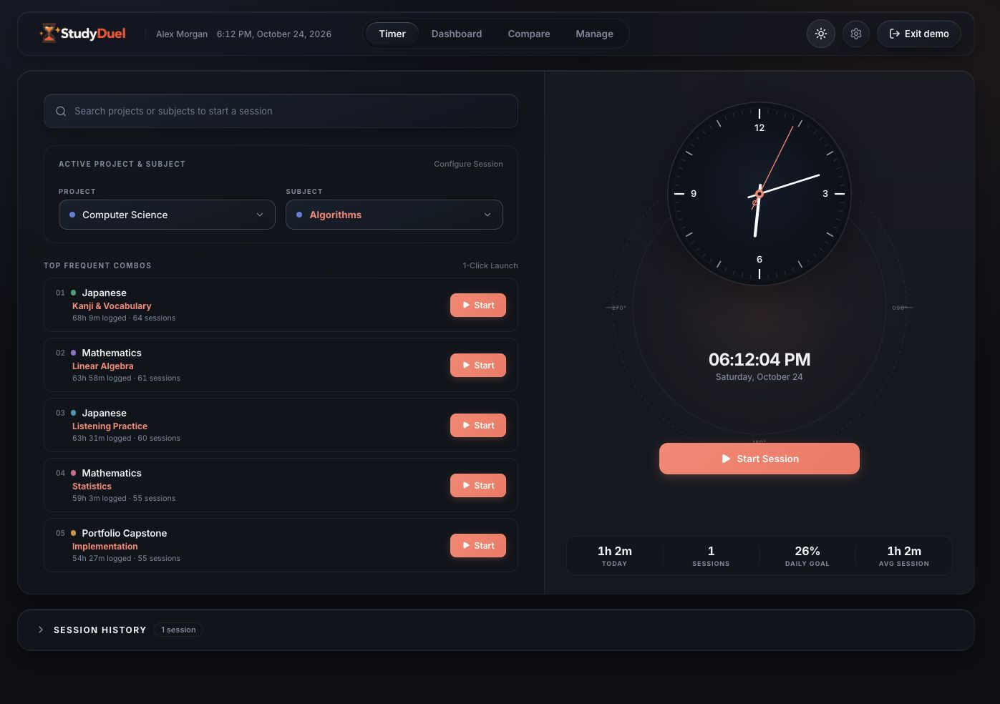
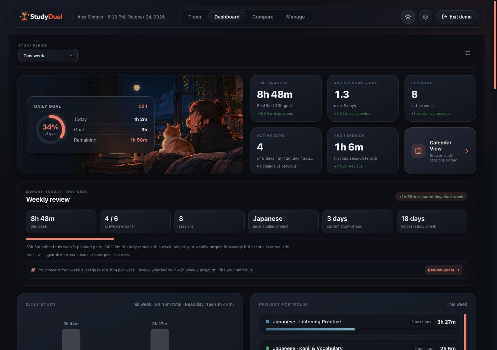
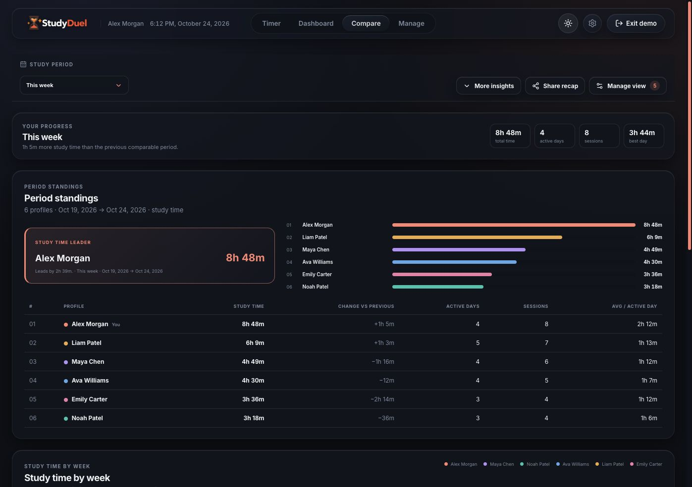
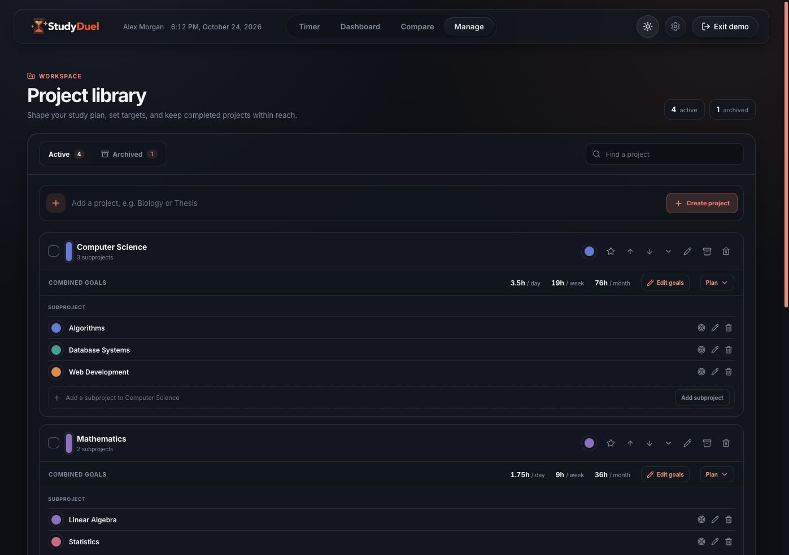

<div align="center">
  

  <h1>StudyDuel</h1>
  <p><strong>Make study time visible. Build momentum with friends.</strong></p>
  <p>Track focused work across projects and subjects, understand your habits, and compare progress with people you choose.</p>

  <p>
    <a href="https://github.com/sisirathck/studyduel-2.0">GitHub repository</a>
    · <a href="#getting-started">Run locally</a>
    · <a href="extension/README.md">Browser extension</a>
  </p>
</div>

> **Website:** A public production domain is not configured in this repository yet. The app runs locally at `http://localhost:5173` during development. Add the deployed HTTPS URL here when one is available.

## See StudyDuel

These screenshots show the app in dark mode with sample demo data. The same screens support the light theme.

<table>
  <tr>
    <td width="50%"><strong>Focus timer</strong><br /></td>
    <td width="50%"><strong>Progress dashboard</strong><br /></td>
  </tr>
  <tr>
    <td width="50%"><strong>Compare progress</strong><br /></td>
    <td width="50%"><strong>Project library</strong><br /></td>
  </tr>
</table>

## What you can do

### Track focused study time

- Start and stop sessions against a project and subject, or use the stopwatch for an open-ended session.
- Choose a Pomodoro, deep-work, or open stopwatch timer mode.
- Find projects and subjects from the timer search, then launch a recent project/subject combination with one click.
- Review, edit, and organize completed sessions. Browse history in the calendar and filter by study area.
- Use the browser extension to start and stop a timer from the toolbar. See the [extension guide](extension/README.md) for setup and browser-specific details.

### Understand your progress

- Review total study time, sessions, active days, daily goals, and average session length.
- See weekly summaries, daily charts, project breakdowns, streaks, and personal records.
- Choose a reporting period, customize dashboard sections, and set your preferred week start.
- Keep a weekly target in view and compare this period with the previous one.

### Study alongside friends

- Connect study partners using invite codes in Settings.
- Choose which connected profiles appear in Compare and customize their chart colors.
- Compare a selected period using standings, study-time trends, active days, sessions, project patterns, and personal records.
- Share a recap containing only your own selected metrics, as text or as a PNG image. On devices that support file sharing, the image opens the native share sheet; otherwise it downloads for you to share.

### Plan projects and personalize your workspace

- Organize projects into subjects, set daily/weekly/monthly goals, reorder or favorite active work, and archive completed projects.
- Configure timer defaults, reminder preferences, chimes, theme, time zone, date format, and display name.
- Import or export workspace data from Settings.
- Choose light, dark, or automatic daylight themes.

## Data and accounts

StudyDuel has two workspace modes:

- **Demo mode** uses sample profiles and sample study history stored in this browser. It does not connect demo activity to real accounts.
- **Signed-in mode** uses PostgreSQL for account and connection records. The app keeps an account-scoped working copy in browser storage and syncs it to the server's workspace-state table, so workspace data can be restored after signing in on another browser. Study-partner comparisons are loaded through the API and limited to connected profiles.

Password registration uses email verification. Configure SMTP or Resend to deliver verification and password-reset codes. Google sign-in is available when Google OAuth credentials are configured. For local exploration, use **Try demo** without configuring an email provider.

## Technology

| Area | Stack |
|---|---|
| Web app | React 19, Vite 8, Lucide React, CSS |
| API | Node.js, Express 5 |
| Database | PostgreSQL, `pg` |
| Accounts | Argon2id password hashing, JWT session cookies, email verification, optional Google sign-in |
| Browser add-on | Manifest V3 extension for Chromium-based browsers and Safari-compatible WebExtensions |

## Getting started

### Requirements

- Node.js `^20.19.0` or `>=22.12.0`
- npm
- Docker Compose with PostgreSQL, or a PostgreSQL instance you can connect to

### Install and configure

```bash
git clone https://github.com/sisirathck/studyduel-2.0.git
cd studyduel-2.0
npm install
cp .env.example .env
```

Edit `.env` with your local database credentials. For the included Docker Compose database, set `POSTGRES_USER`, `POSTGRES_PASSWORD`, and `POSTGRES_DB`, then make `DATABASE_URL` match those values. Replace the example password before using the database.

Start PostgreSQL and the app:

```bash
docker compose up -d db
npm run dev
```

Open <http://localhost:5173>. Vite serves the React app and forwards `/api` requests to Express on port `3001`. The server applies the numbered SQL migrations on startup. Use **Try demo** to explore immediately; email delivery is only needed to register a password-based account.

### Environment variables

| Variable | Required | Description |
|---|---|---|
| `DATABASE_URL` | Yes | PostgreSQL connection string |
| `AUTH_SECRET` | Yes for deployment | Random secret of at least 32 characters for signed sessions. Do not use the development fallback in production. |
| `PORT` | No | Express port; defaults to `3001` |
| `NODE_ENV` | No | Set to `production` in deployment so secure cookie settings are used. |
| `SMTP_HOST`, `SMTP_PORT`, `SMTP_SECURE`, `SMTP_USER`, `SMTP_PASS` | For SMTP email | SMTP settings for verification and reset emails |
| `EMAIL_FROM` | For email delivery | Sender address accepted by your mail provider |
| `RESEND_API_KEY` | Alternative email provider | Resend API key; configure `EMAIL_FROM` as a verified sender |
| `GOOGLE_CLIENT_ID` | Optional | Google OAuth client ID used to enable Google sign-in |
| `POSTGRES_USER`, `POSTGRES_PASSWORD`, `POSTGRES_DB` | For Docker Compose | Initial local PostgreSQL container settings |

Never commit `.env`, OAuth credentials, SMTP passwords, API keys, or production user data.

## Commands

| Command | What it does |
|---|---|
| `npm run dev` | Start the Vite development server and Express API |
| `npm run build` | Create the production frontend in `dist/` |
| `npm start` | Start Express and serve `dist/` when it exists |
| `npm run build:start` | Build the frontend, then start Express |
| `npm run server` | Start only the Express server |
| `npm run lint` | Run Oxlint |
| `npm run preview` | Preview the Vite build locally |

## API and database

The Express API currently mounts these route groups:

| Route | Purpose |
|---|---|
| `/api/health` | Health response |
| `/api/auth` | Registration, email verification, login, password reset, profile, Google sign-in, and logout |
| `/api/workspace` | Signed-in workspace-state sync |
| `/api/connections` | Invite codes, partner connections, and comparison data |
| `/api/projects` | Project API endpoints |
| `/api/timer` | Timer API endpoints |

Database schema and migrations are in [`database/`](database/). The numbered migrations add account/workspace persistence, invites, email verification, and password reset support. The app's signed-in workspace is synchronized as account-scoped browser-storage items, while account credentials and relationships are stored in PostgreSQL.

## Deployment and domain

There is no production domain or automatic deployment target declared in this repository. To publish your own instance:

1. Provision a host, PostgreSQL database, and a domain you control.
2. Point the domain's DNS records at the host and configure HTTPS.
3. Set production environment variables, including a strong `AUTH_SECRET`, database credentials, and email-provider settings.
4. Build and launch the app with `npm run build` and `npm start` (or your process manager of choice).
5. Configure your reverse proxy to forward application traffic to Express on port `3001`, preserving `/api` and SPA routes.
6. Set the public URL in this README and configure any OAuth/email provider callback or sender settings for that domain.

For a manual VPS update after deployment, the basic application steps are:

```bash
git pull origin main
npm install
npm run build
pm2 restart studyduel --update-env
```

For a first PM2 launch, use `pm2 start npm --name studyduel -- start` and `pm2 save`. Adapt the branch, process name, database migrations, and reverse-proxy configuration to your host. A GitHub push alone does not deploy the app.

## Repository map

```text
database/             PostgreSQL schema and migrations
docs/screenshots/     README screenshots captured from demo mode
extension/            Browser extension source and install guide
public/               Static app images, logos, and icons
scripts/              Development and asset scripts
server/               Express API, authentication, and database access
src/components/       Shared React components
src/context/           Theme context
src/data/              Demo workspace and account workspace sync
src/modules/           Timer, dashboard, compare, manage, settings, calendar
```

## Contributing

Issues and pull requests are welcome. Please keep screenshots and examples synthetic, label planned work as planned, and never include credentials or personal study histories in commits.

## License

This repository does not currently include a license file. Until a license is added, the source remains all rights reserved by its owner; please ask before redistributing or using it outside the rights granted by GitHub's default repository terms.
