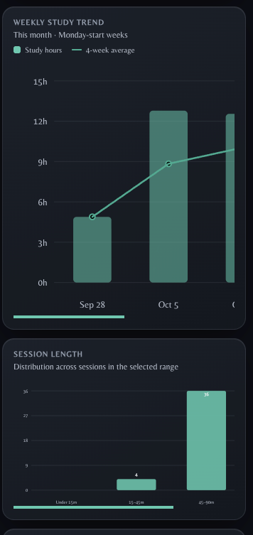
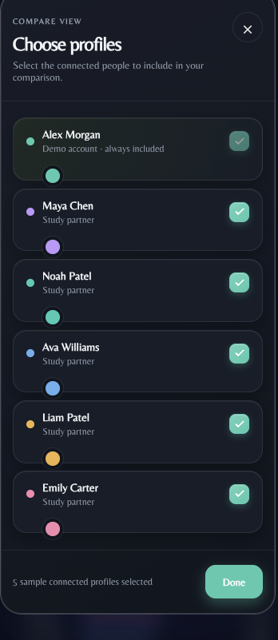
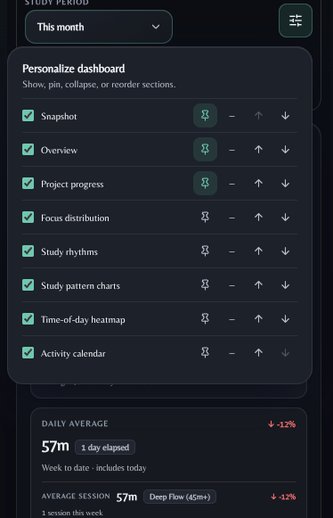

<div align="center">
  

  <h1>PlotHour</h1>
  <p><strong>Turn time into progress.</strong></p>
  <p>A focused study tracker for building a steady rhythm, understanding your habits, and reaching your goals.</p>

  <p>
    <a href="https://plothour.com"></a>
    <a href="https://github.com/sisirathck/studyduel-2.0"></a>
  </p>

  <p><sub>React · Vite · Express · PostgreSQL</sub></p>
</div>

---

## A look inside

Recent mobile captures from the app. Demo profiles and study sessions use sample data.

<p align="center">
  
  
  
</p>

<p align="center"><sub>Study analytics · Compare profiles · Personalize your dashboard</sub></p>

## Make study time visible

PlotHour brings planning, focus sessions, and progress review into one workspace. Use it for solo study or invite study partners when a little shared accountability helps.

| Focus | Understand | Plan | Compare |
|---|---|---|---|
| Run a stopwatch, Pomodoro, or deep-work session. Start from a project, subject, or recent combination. | Explore weekly and monthly summaries, trends, streaks, session patterns, and time-of-day insights. | Set project and subject goals by day, week, or month, choose study days, and follow goal pace. | Compare selected periods with connected partners, choose profile colors, and share a recap of your own selected metrics. |

### Built for a real study routine

- **Timer and history:** track focused work, add session notes, edit entries, and browse activity in a calendar.
- **Flexible dashboard:** choose a reporting period, rearrange or pin sections, and follow progress against your goals.
- **Project library:** organize projects and subjects, set recurring goals, and archive completed work.
- **Accountability with control:** connect partners by invite, choose who appears in comparisons, and share only the recap details you select.
- **Your workspace, your theme:** choose light, dark, or automatic daylight appearance, plus your preferred time zone, date format, and week start.
- **Mobile-friendly layouts:** access the timer, dashboard, and comparison tools on smaller screens.
- **Optional browser extension:** manage sessions from a browser toolbar. See the [extension guide](extension/README.md).

## Run PlotHour locally

### Requirements

- Node.js `^20.19.0` or `>=22.12.0`
- npm
- Docker Compose and PostgreSQL, or an existing PostgreSQL database

### Start the app

```bash
git clone https://github.com/sisirathck/studyduel-2.0.git
cd studyduel-2.0
npm install
cp .env.example .env
```

Set a local database password in `.env` and make sure `DATABASE_URL` uses the same database, user, and password. Then start PostgreSQL and PlotHour:

```bash
docker compose up -d db
npm run dev
```

Open <http://localhost:5173>. The development command starts Vite and the Express API; Vite forwards `/api` requests to the API on port `3001`. Database schema updates are applied by the server at startup. Choose **Try demo** to explore with sample data. Email delivery and OAuth credentials are only needed when configuring those account sign-in options.

### Configuration

| Variable | Purpose |
|---|---|
| `DATABASE_URL` | PostgreSQL connection string |
| `POSTGRES_USER`, `POSTGRES_PASSWORD`, `POSTGRES_DB` | Local database settings for Docker Compose |
| `AUTH_SECRET` | Random secret of at least 32 characters for account sessions; set it locally for account sign-in and in production |
| `PORT` | Express port; defaults to `3001` |
| `SMTP_HOST`, `SMTP_PORT`, `SMTP_SECURE`, `SMTP_USER`, `SMTP_PASS`, `EMAIL_FROM` | SMTP delivery for verification and password-reset email |
| `RESEND_API_KEY` | Alternative email provider; use a verified `EMAIL_FROM` sender |
| `GOOGLE_CLIENT_ID` | Optional Google sign-in configuration |

Keep `.env`, database credentials, OAuth settings, and mail-provider keys out of version control. The included `.env.example` is for local development; replace its placeholder values before use.

## Useful commands

| Command | Description |
|---|---|
| `npm run dev` | Start the Vite frontend and watched Express API for development |
| `npm run build` | Build the frontend into `dist/` |
| `npm start` | Start Express; serve `dist/` when a production build exists |
| `npm run build:start` | Build the frontend, then start Express |
| `npm run server` | Start the Express API server |
| `npm run lint` | Run Oxlint |
| `npm run preview` | Preview the Vite production build locally |

## Demo, accounts, and data

- **Demo mode** is an instant product tour with generated sample profiles and history stored in the current browser.
- **Signed-in mode** uses PostgreSQL for accounts, timers, projects, goals, and per-user workspace sync. Your personal workspace is scoped to your account.
- **Study partners** are connected by invite. Comparison views use the profiles you select; disconnecting a partner removes that connection from your comparison.

The API health check is available at `/api/health`. API route groups include `/api/auth`, `/api/projects`, `/api/timer`, `/api/workspace`, `/api/connections`, `/api/analytics`, and `/api/admin`.

## Project layout

```text
database/          PostgreSQL schema and migrations
docs/screenshots/  README product captures
extension/         Browser extension and setup guide
public/            Logos, icons, and static assets
scripts/           Development scripts
server/            Express API, authentication, and database access
src/components/    Shared React components
src/context/       Theme and application contexts
src/data/          Demo workspace and account workspace sync
src/modules/       Timer, dashboard, compare, manage, settings, and calendar
```

## Contributing

Bug reports and pull requests are welcome. Keep demo data synthetic, avoid committing secrets or personal study histories, and include screenshots when a change affects the interface.

## License

This repository does not currently include a license file. Unless you have separate permission, the source is not licensed for redistribution or reuse.
